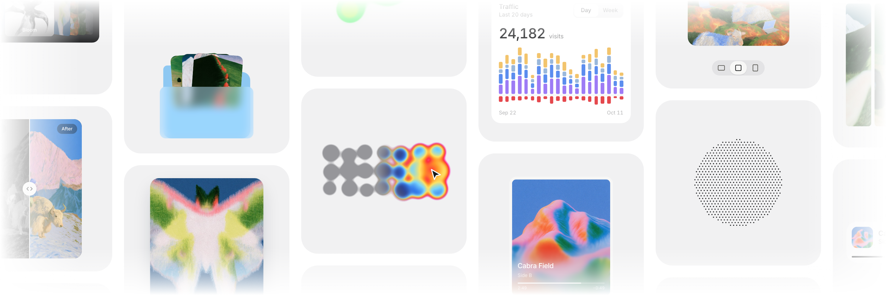

<div align="center">
  <br />
  <a href="https://bencho.dev"></a>
  <h1>Bencho</h1>
  <h3>Interactive React blocks and interface sounds, free to take.</h3>
  <p>40 live, tunable blocks and 24 synthesised sounds from <a href="https://bencho.dev">bencho.dev</a>.<br />Copy a folder, paste it in, ship it.</p>
  <p>
    <a href="LICENSE"></a>
    
    
  </p>
  <p>
    <a href="https://bencho.dev"><strong>Website</strong></a> ·
    <a href="https://bencho.dev/sounds"><strong>Sounds</strong></a> ·
    <a href="https://bencho.dev/mcp"><strong>MCP</strong></a> ·
    <a href="https://bencho.dev/pricing"><strong>Pro</strong></a>
  </p>
  <br />
</div>

<a href="https://bencho.dev"></a>

## What's inside

| | Count | Where |
| --- | ---: | --- |
| **Blocks** | 40 | [`blocks/`](blocks) — one folder each: the component, its CSS and a README with every prop |
| **Sounds** | 24 | [`sounds/sounds.ts`](sounds) — one file, Web Audio, no dependencies |
| **Tokens** | 35 | [`tokens.css`](tokens.css) — the light and dark values the blocks read |

Every block is live on bencho.dev, with its knobs, before you take it.

## Use a block

1. Copy a folder from [`blocks/`](blocks), for example `blocks/like`.
2. Add [`tokens.css`](tokens.css) to your app once.
3. Install what the block's README lists (usually `framer-motion` and `lucide-react`).

```tsx
import "./tokens.css";
import { Like } from "./blocks/like/Like";
import "./blocks/like/Like.css";

export default function Page() {
  return <Like color="Ink" burst={70} />;
}
```

Every prop is optional and matches a knob on the site, so what you tuned on bencho.dev is what you pass in. Dark mode follows `data-theme="dark"` on any ancestor, or the system setting.

**With an AI agent:** every block on bencho.dev has a **Copy prompt** button that hands your agent the whole file and how to wire it in. Pro members can connect the [Bencho MCP](https://bencho.dev/mcp) to Claude Code, Cursor or Codex and ask for blocks by name.

## Use the sounds

```ts
import { play } from "./sounds/sounds";

button.addEventListener("click", () => play("tick"));
```

All 24 are listed in [`sounds/`](sounds).

## Run the playground

```bash
npm install
npm run dev
```

Every block and sound on one page, with a light and dark switch.

## The blocks

### Hover

| Block | What it does | Live |
| --- | --- | --- |
| [Stacked bars](blocks/stacked-bars) | A month of visits as stacked bars; run along them and one day is ringed while a tooltip glides beside it, and Day / Week regrows the bars. | [Demo](https://bencho.dev/blocks/stacked-bars) |
| [Toast stack](blocks/toast-stack) | Three toasts stacked at the edge, the two behind peeking out above the front one; point at them and they spring apart into a list. | [Demo](https://bencho.dev/blocks/toast-stack) |
| [Emoji reactions](blocks/emoji-reactions) | Press the button and the message turns into a pill of emoji; pick one and it flies down to its reaction chip as the count rolls up. | [Demo](https://bencho.dev/blocks/emoji-reactions) |
| [Heat map](blocks/heat-word) | Dots that melt into a heat map under your cursor; press for the next shape. | [Demo](https://bencho.dev/blocks/heat-word) |
| [Eye tracker](blocks/eye-tracker) | Two eyes on a soft cube that turn to follow your cursor around the block. | [Demo](https://bencho.dev/blocks/eye-tracker) |
| [Particles](blocks/particles) | Dots scatter from your pointer and spring home; press for a shockwave. | [Demo](https://bencho.dev/blocks/particles) |
| [Image accordion](blocks/image-accordion) | Hover a photo and it opens while its neighbours give way around it. | [Demo](https://bencho.dev/blocks/image-accordion) |
| [Action node](blocks/action-node) | An automation step card with its controls folded into the corner. | [Demo](https://bencho.dev/blocks/action-node) |
| [Magnifying dock](blocks/dock) | A dock whose icons swell toward your cursor, the nearest growing most. | [Demo](https://bencho.dev/blocks/dock) |
| [Escape button](blocks/escape) | A button that slides away from your cursor, and then gives up. | [Demo](https://bencho.dev/blocks/escape) |
| [Tilt card](blocks/tilt) | A photo card that sinks under your pointer instead of rising to meet it. | [Demo](https://bencho.dev/blocks/tilt) |

### Drag

| Block | What it does | Live |
| --- | --- | --- |
| [Folding bill](blocks/folding-bill) | A bill you can grab, drag and fold; plain or with the dollar print. | [Demo](https://bencho.dev/blocks/folding-bill) |
| [Image compare](blocks/image-compare) | Drag the line to compare two pictures; flick it and it glides to the edge. | [Demo](https://bencho.dev/blocks/image-compare) |
| [Signature pad](blocks/signature) | Sign it; the ink thins with speed, and Clear rewinds it stroke by stroke. | [Demo](https://bencho.dev/blocks/signature) |
| [Upload dropzone](blocks/upload-dropzone) | Drag a file into the box to upload it; one that is too big gets refused. | [Demo](https://bencho.dev/blocks/upload-dropzone) |
| [Glass bubble](blocks/glass-bubble) | Drag a ball of glass over a photo and watch it bend the picture beneath. | [Demo](https://bencho.dev/blocks/glass-bubble) |
| [Slide to confirm](blocks/slide-confirm) | Push the handle across; past the mark it takes over and finishes itself. | [Demo](https://bencho.dev/blocks/slide-confirm) |
| [Pull to refresh](blocks/pull) | Pull the card down and it stretches; let go past the line to refresh. | [Demo](https://bencho.dev/blocks/pull) |
| [Dragging ball](blocks/drag-ball) | A ball you grab: it swells under the pointer and squeezes as you hold it. | [Demo](https://bencho.dev/blocks/drag-ball) |

### Press

| Block | What it does | Live |
| --- | --- | --- |
| [Asset swap](blocks/asset-swap) | Flip the arrow to reverse the swap; tap a coin to pick another. | [Demo](https://bencho.dev/blocks/asset-swap) |
| [Like](blocks/like) | Press the heart and it pops with a burst while the count rolls up a digit. | [Demo](https://bencho.dev/blocks/like) |
| [Voice note](blocks/voice-note) | Hold to record a waveform, slide left to bin it, let go to play it back. | [Demo](https://bencho.dev/blocks/voice-note) |
| [Dynamic island](blocks/dynamic-island) | A live timer in a black pill: press it to grow into the full activity, and back again. | [Demo](https://bencho.dev/blocks/dynamic-island) |
| [Generate](blocks/generate) | Press Generate and an image resolves under glass, broad shapes first. | [Demo](https://bencho.dev/blocks/generate) |
| [Step player](blocks/step-player) | Press play and each step fills as a bar, then eases on to the next dot. | [Demo](https://bencho.dev/blocks/step-player) |
| [Todo tower](blocks/todo-tower) | A to-do list stacked like bricks; take one out and the rest come down. | [Demo](https://bencho.dev/blocks/todo-tower) |
| [Checklist](blocks/checklist) | Tick a task and the box fills, the tick draws in and the words strike out. | [Demo](https://bencho.dev/blocks/checklist) |
| [Palette](blocks/palette) | A set of colours that go together; press for a new palette. | [Demo](https://bencho.dev/blocks/palette) |
| [Liquid toggle](blocks/liq-toggle) | A switch whose droplet stretches as it slides across the track. | [Demo](https://bencho.dev/blocks/liq-toggle) |
| [Now playing](blocks/sound) | A now-playing bar that opens into a full player and folds back as one. | [Demo](https://bencho.dev/blocks/sound) |
| [Search](blocks/seek) | Press the search icon and it opens into the field as one object. | [Demo](https://bencho.dev/blocks/seek) |
| [Create menu](blocks/liq-create) | Press the pill and it spreads into the create menu it was all along. | [Demo](https://bencho.dev/blocks/liq-create) |

### Slide

| Block | What it does | Live |
| --- | --- | --- |
| [Time scrubber](blocks/time-scrubber) | Drag the ruler to set a time; fling it and it coasts to the nearest step. | [Demo](https://bencho.dev/blocks/time-scrubber) |
| [Slosh slider](blocks/slosh) | A slider whose fill has weight: drag fast and it sloshes past the handle. | [Demo](https://bencho.dev/blocks/slosh) |

### Type

| Block | What it does | Live |
| --- | --- | --- |
| [Label input](blocks/label-input) | A field whose label lifts into the top edge as you focus it. | [Demo](https://bencho.dev/blocks/label-input) |
| [One-time code](blocks/one-time-code) | Six boxes that are one field: paste, autofill and backspace all just work. | [Demo](https://bencho.dev/blocks/one-time-code) |

### Select

| Block | What it does | Live |
| --- | --- | --- |
| [Magnetic select](blocks/magnet-select) | Press an option and it swells as the rest are pushed out of its way. | [Demo](https://bencho.dev/blocks/magnet-select) |
| [Assignees](blocks/picker) | Assign people from a list and their faces stack up in the pill. | [Demo](https://bencho.dev/blocks/picker) |
| [Aspect ratio](blocks/aspect) | Switch the crop between 4:3, 1:1 and 3:4, keeping the same area each time. | [Demo](https://bencho.dev/blocks/aspect) |

### Swipe

| Block | What it does | Live |
| --- | --- | --- |
| [Carousel](blocks/carousel) | Cards on a turntable that drift, lean under your pointer and swipe round. | [Demo](https://bencho.dev/blocks/carousel) |

## Bencho Pro

The free set is a selection. **[Bencho Pro](https://bencho.dev/pricing)** opens everything on bencho.dev: all 120+ blocks, 130+ sounds with layering and downloads, an unlimited Bench to arrange them, full source in the Code tab, and the MCP for your agent. Every block added later is included.

## License

The blocks, sounds and tokens in this repository are [MIT](LICENSE): use them in anything, change them, sell what you build.

- The photographs on bencho.dev are not included; blocks that use pictures leave the image list empty for yours.
- The Bencho name and goat mark are not part of the licence.
- Two sounds are rebuilt from [cuelume](https://cuelume.dev) — see [THIRD_PARTY.md](THIRD_PARTY.md).
- Pro blocks are not in this repository and are under the [Bencho Pro licence](https://bencho.dev/licence#pro).

---

<div align="center">
  Made by <a href="https://x.com/cabralorenzo">Lorenzo Cabra</a> · <a href="https://x.com/benchodev">@benchodev</a>
</div>
